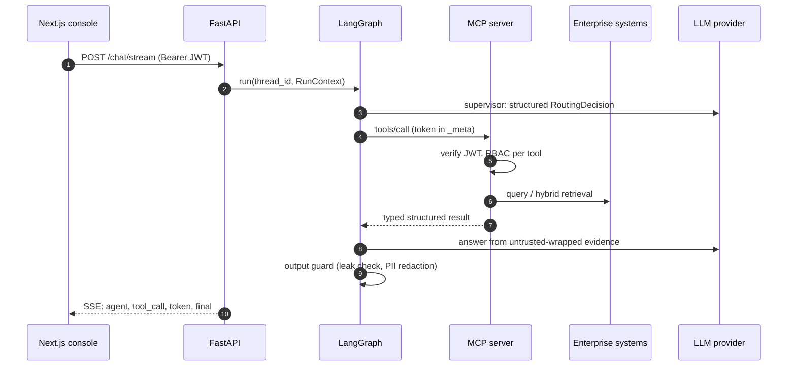
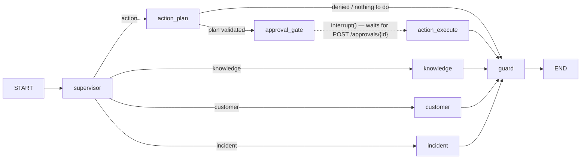

# Architecture

## Request flow

## Components

| Component | Path | Responsibility |
|---|---|---|
| API | `apps/api` | Auth, rate limiting, `/chat`, `/chat/stream` (SSE), `/approvals`, `/audit`, `/tools`, `/metrics` |
| Chat service | `apps/api/service.py` | Runs the graph, creates approvals on interrupt, resumes with `Command(resume=...)`, writes audit events |
| Agent graph | `agents/graph.py` | Supervisor → knowledge / customer / incident / action → output guard |
| MCP gateway | `agents/runtime.py` | The **only** way agents reach data. In-process or Streamable HTTP. Adds tracing, metrics and the audit trail |
| MCP server | `apps/mcp_server` | 12 tools with Pydantic I/O schemas, per-tool RBAC, approval-grant check for writes |
| RAG | `rag/` | Loaders (md, pdf), table linearisation, recursive chunking, embeddings, pgvector / in-memory store, BM25, RRF, reranker, similarity gate, injection quarantine |
| LLM layer | `llm/` | Provider protocol with mock, OpenAI, Azure OpenAI and Anthropic adapters, plus a tracing/cost wrapper |
| Security | `security/` | JWT, RBAC matrix, approval grants, injection scanner, PII redaction, rate limiter |
| Storage | `storage/` | Audit log, approvals, LangGraph checkpointer. In-memory or Postgres, chosen by `DATABASE_URL` |
| Observability | `observability/` | OpenTelemetry spans (`chat.request` → `agent.*` → `mcp.tool.*` → `llm.*`), Prometheus metrics, JSON logs |
| Frontend | `apps/frontend` | Next.js 16 + Tailwind ops console |

## Graph

* **Supervisor** routes the request with structured output (`RoutingDecision`) and flags injection attempts in the user's input.
* **Knowledge** calls `search_knowledge_base`. If the best chunk is below `MIN_SIMILARITY`, it returns *insufficient context* instead of guessing. Otherwise it answers only from `<untrusted_document>`-wrapped evidence, with `[DOC-xxx]` citations.
* **Customer** reads the customer, their services, active incidents in their city and the 5G runbook. It runs deterministic eligibility checks and masks PII before any LLM call.
* **Incident** looks up an incident by ID, or summarises active incidents and network status for the regions mentioned.
* **Action** extracts an `ActionPlan` and validates it: entity IDs must appear in the user's message, the role must be allowed the tool, and the referenced entities must exist. It then pauses at `interrupt()`. The checkpoint is persisted, so a different instance can resume it (this is tested against Postgres).
* **Guard** runs on every path. It blocks system-prompt leakage (canary token plus verbatim-line check) and redacts PII.

## Deployment topologies

| Mode | Stores | MCP | Use |
|---|---|---|---|
| `uvicorn` / tests / Vercel | In-memory | In-process | Development, CI, the public demo |
| `docker compose up` | Postgres + pgvector | Separate container over Streamable HTTP | Full local stack with traces in Jaeger |
| Azure (`infrastructure/terraform`) | Postgres Flexible Server + pgvector | Internal Container App | Production reference |

The public Vercel demo is serverless. Pending approvals live in instance memory there, so one may expire if the instance is recycled; the UI shows a clear error when that happens. Every other deployment uses the Postgres checkpointer.
